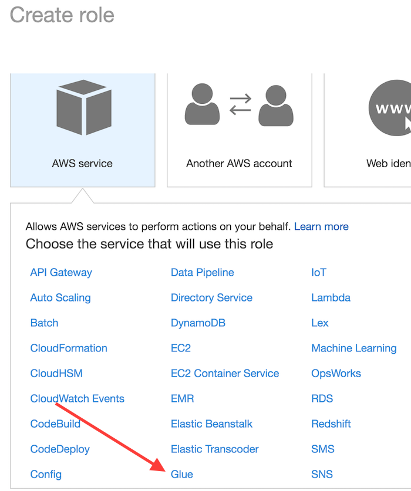
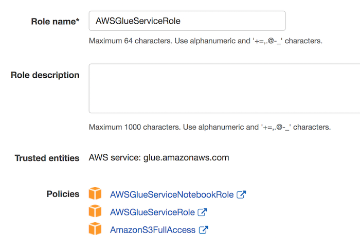
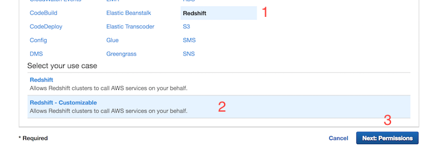
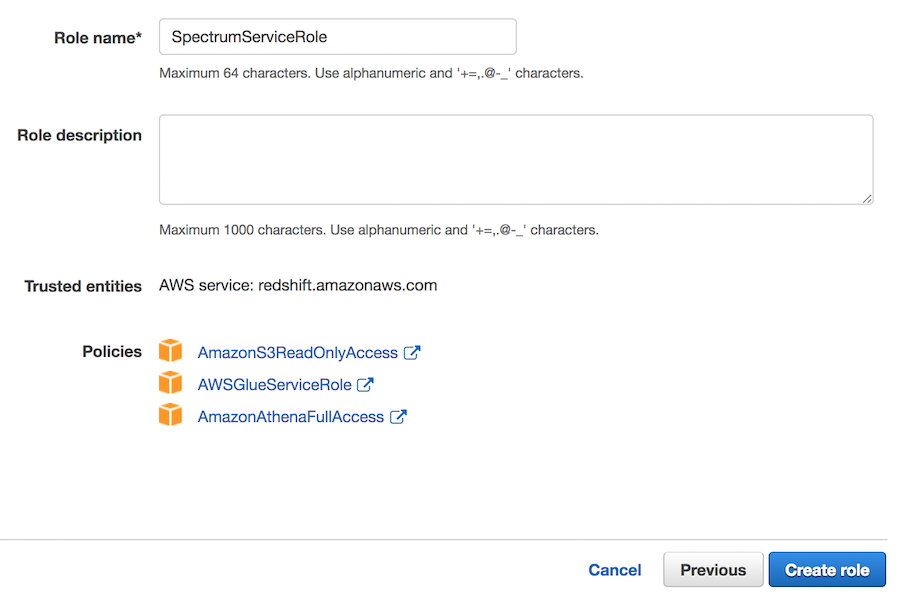
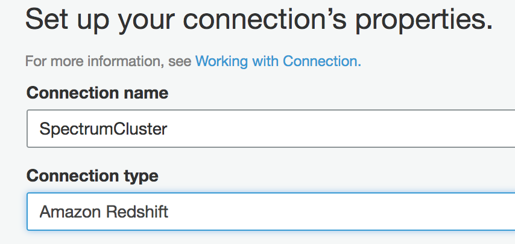

# Part 1 - Set Up

## References
1. [Setting up IAM Permissions for AWS Glue](http://docs.aws.amazon.com/glue/latest/dg/getting-started-access.html)

2. [Setting up IAM Permissions for Amazon Redshift Spectrum](http://docs.aws.amazon.com/redshift/latest/dg/c-spectrum-iam-policies.html)

## Prerequisits
1. Create an [AWS account](https://aws.amazon.com/free/)

## Setup IAM Permissions for AWS Glue
1. Access the IAM console and select **Users**.  Then select your username

2. Click **Add Permissions** button

3. From the list of managed policies, attach the following:
	* AWSGlueConsoleFullAccess
	* CloudWatchLogsReadOnlyAccess
	* AWSCloudFormationReadOnlyAccess

## Setup AWS Glue default service role
1. From the IAM console click **Roles** and create a new role

2. Select **Glue** from the list of services and click the **Next:Permissions** button

4. From the list of managed policies, attach the following by searching for their name and click **Next:Review** when done.
	* AWSGlueServiceRole
	* AWSGlueServiceNotebookRole
	* AmazonS3FullAccess

5. Give your role a name, such as **AWSGlueServiceRole** and click **Create Role**

## Setup Amazon Redshift Spectrum service role
1. From the IAM console click **Roles** and create a new role

2. Select **Redshift** from the list of services followed by **Redshift - Customizable** use case and click the **Next:Permissions** button

3. From the list of managed policies, attach the following by searching for their name and click **Next:Review** when done.
	* AWSGlueServiceRole
	* AmazonS3ReadOnlyAccess
	* AmazonAthenaFullAccess

4. Give your role a name, such as **SpectrumServiceRole** and click **Create Role**

5. Once created, navigate back to the **Roles** section of IAM console and search for the role we just created.  Select your role and copy the **Role ARN** to your clipboard

6. If you already have a Redshift cluster follow [these instructions](http://docs.aws.amazon.com/redshift/latest/dg/c-getting-started-using-spectrum-add-role.html) to attach the new role to it.  If you do not have a cluster go ahead and create one making sure to associate this new role with the cluster at creation time.

## Setup Glue Data Catalog Connection to Redshift
1. Open the AWS Glue Console and select **Connections** from the left hand side under the Data Catalog section

2. Click **Add Connection** button

3. Give your connection a name and select **Amazon Redshift** from the connection type drop down.  Click **Next**

4. From the cluster drop down select your Redshift cluster.  Enter your password, click **Next** and then **Finish**

5. After the connection is created, select your connection and click **Test Connection**.  If the test fails, confirm the database name, username and password and try again.

Now that your connection is successful you can move on to the next section.