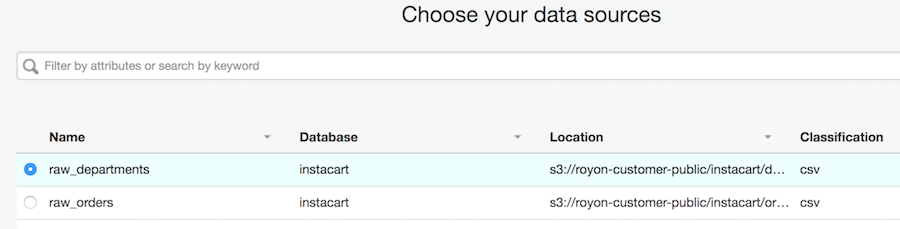
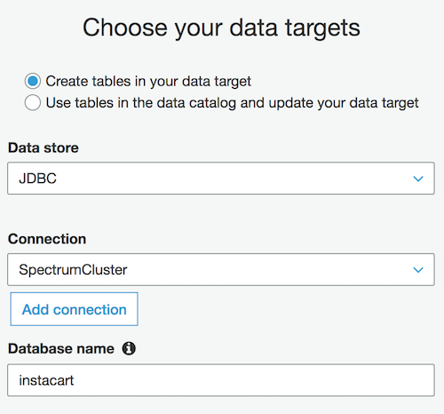
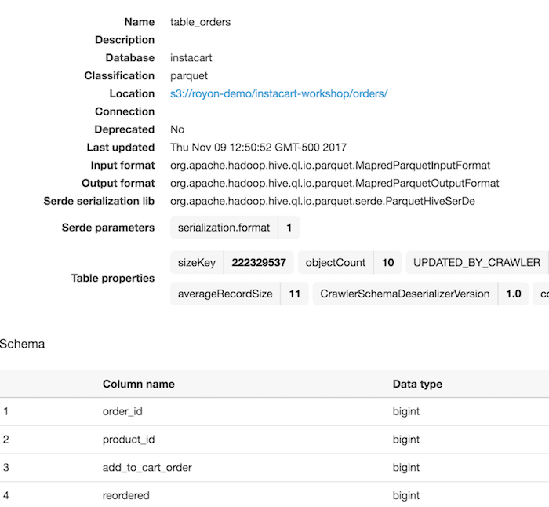
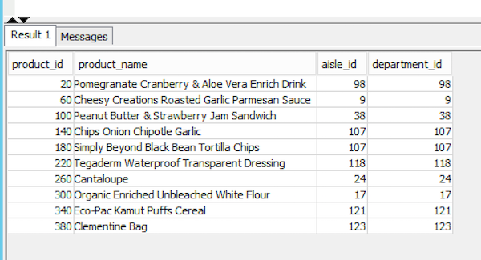
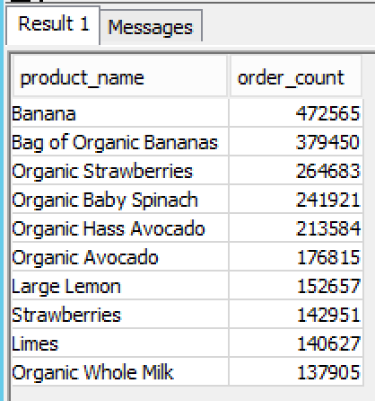

# Part 2 - Crawling, Transforming and Querying

## References
1. [Apache Spark](https://spark.apache.org/)

2. [PySpark API Reference](http://spark.apache.org/docs/2.1.0/api/python/pyspark.sql.html)


## The Data Source
We will use a public data set provided by [Instacart in May 2017](https://tech.instacart.com/3-million-instacart-orders-open-sourced-d40d29ead6f2) to look at Instcart's customers' shopping pattern.  You can find the data dictionary for the data set [here](https://gist.github.com/jeremystan/c3b39d947d9b88b3ccff3147dbcf6c6b)

## Crawling
1. Open the AWS Glue console

2. Select **Crawler** and click **Add Crawler**
3. Give your crawler a name and choose the Glue IAM role we created in Part 2.  **AWSGlueServiceRole**
4. Select **S3** as the **Data Source** and specify a path in **another account**.  Paste **s3://royon-customer-public/instacart/** as the S3 path.  
5. Do not add any additional data sources and select **Run On Demand** for frequency
6. Create a new database called **instacart** and enter **raw_** as the table prefix
7. Click **Finish** to complete creating the crawler
8. Run the new crawler

##  Transforming the Data
Before we get started with creating a Glue ETL job, we need to make one small change to the created tables.
Select Tables in the Data Catalog and search for **raw_products**. Click **raw_products** to open up the table details.
As you can see the Classification is *UNKNOWN*.  We need to fix it before continuing.
1. Click **Edit Table**

2. Scroll down to **Classification** and change the value to **csv**
3. Click **Apply** to save the changes
You may have also noticed that we don't have any column, that's ok, we'll fix this soon.

We'll now create a Glue ETL job that will process all 5 tables that the crawler created. We will create three fact tables in Redshift to hold the aisles, products and departments data.  We will save the prior orders data in a Parquet optimized file format to Amazon S3.

From the Glue ETL menu select **Jobs** and click **Add Job**
1. Give your job a name, **instacart_etl** and select our service role.  Leave all of the other options unchanged but provide a **Temporary Directory**

2. From the **Data Sources** list select one of the Instcart tables, lets say **raw_departments**.  We can only select one table at this stage.



3. When choosing our data targets select **Create tables in your data target**. Select **JDBC** for data store.  Enter the database name of your Redshift cluster and click **Next**



4. In this step we can change the source to target column mapping but we will not change this now.  Click **Next**

5. Click **Finish** to complete creating our ETL 

As you can see, AWS Glue created a script for you to get started. If you remember we still need to fix the Products table.  Select everything in the script window and replace it with the code below.

>Make sure you update `OUTPUT_S3_PATH` to point to your own S3 bucket, otherwise the job will fail.

```python
import sys
from awsglue.transforms import *
from awsglue.utils import getResolvedOptions
from pyspark.context import SparkContext
from awsglue.context import GlueContext
from awsglue.dynamicframe import DynamicFrame
from awsglue.job import Job

##################
## Update these variables with your own information
##################
GLUE_DB_NAME = "instacart"
REDSHIFT_DB_NAME = "instacart"

TBL_RAW_PRODUCTS = "raw_products"
TBL_RAW_ORDERS = "raw_orders"
TBL_RAW_ORDERS_PRIOR = "raw_orders_prior"
TBL_RAW_DEPT = "raw_departments"

OUTPUT_S3_PATH = "s3://your-bucket/prefix/"
##################

## @params: [JOB_NAME]
args = getResolvedOptions(sys.argv, ['JOB_NAME'])

## Create Glue and Spark context variables
sc = SparkContext()
glueContext = GlueContext(sc)
spark = glueContext.spark_session
job = Job(glueContext)
job.init(args['JOB_NAME'], args)

## Define the source tables from where to read data
products = glueContext.create_dynamic_frame.from_catalog(database = GLUE_DB_NAME, table_name = TBL_RAW_PRODUCTS, transformation_ctx = "products").toDF()
orders_prior = glueContext.create_dynamic_frame.from_catalog(database = GLUE_DB_NAME, table_name = TBL_RAW_ORDERS_PRIOR, transformation_ctx = "orders_prior").toDF()
departments = glueContext.create_dynamic_frame.from_catalog(database = GLUE_DB_NAME, table_name = TBL_RAW_DEPT, transformation_ctx = "departments").toDF()

## Fix the products table which was missing columns and types
p_df = products.withColumn('product_id', products.col0.cast('bigint')) \
.withColumn('product_name', products.col1.cast('string')) \
.withColumn('aisle_id', products.col2.cast('bigint')) \
.withColumn('department_id', products.col2.cast('bigint')) \
.na.drop('any')
prods = p_df.select('product_id', 'product_name', 'aisle_id', 'department_id')

## Drop records that contain any null values
prods = prods.na.drop('any')
orders = orders_prior.na.drop('any')
departments = departments.na.drop('any')

## Convert from Spark DataFrame back to Glue DynamicFrame
df_prods = DynamicFrame.fromDF(prods, glueContext, 'df_prods')
df_depts = DynamicFrame.fromDF(departments, glueContext, 'df_depts')

## Write departments table to Redshift
datasink1 = glueContext.write_dynamic_frame.from_jdbc_conf(frame = df_depts, catalog_connection = "SpectrumCluster", connection_options = {"dbtable": "departments", "database": REDSHIFT_DB_NAME}, redshift_tmp_dir = args["TempDir"], transformation_ctx = "datasink1")
## Write products table to Redshift
datasink2 = glueContext.write_dynamic_frame.from_jdbc_conf(frame = df_prods, catalog_connection = "SpectrumCluster", connection_options = {"dbtable": "products", "database": REDSHIFT_DB_NAME}, redshift_tmp_dir = args["TempDir"], transformation_ctx = "datasink2")

## Write orders data to S3 in Parquet format
orders.coalesce(10) \
  .write \
  .mode('overwrite') \
  .parquet(OUTPUT_S3_PATH + 'orders/')

job.commit()
```

Now save and run your ETL job.  One thing to note is that we're writing out a new set of data to our own S3 bucket.
We need to configure a crawler to scan this new bucket and create appropriate tables in the Data Catalog so we can query them with Athena.

There is a little bit of cleanup we need to do in order to help the crawler produce better results.  When Apache Spark, what is used by the Glue ETL, does its work
it generates some temporary files. We will need to delete them.  In the output S3 bucket delete files named **name_$folder$**, **_metadata** and **_common_metadata**

From the Glue console select **Crawlers** and create a new crawler.  Point it to the top S3 bucket where you saved your results defined by **OUTPUT_S3_PATH** in the script above.  In my case that will be **s3://royon-demo/instacart-workshop/orders/**.  Make sure you configure the table prefix to something other than raw_ so you can differentiate them from the previous ones we created, I used **table_**.  When the ETL job completes we can run our new crawler.  After the crawler completes you should see your new orders table.  Also look in Redshift to verify that products and department tables were created and have data.



## Using Redshift Spectrum

To run queries on Redshift you will need a SQL tool such as SQL Workbench/J.  You can find instructions to set it up [here](http://docs.aws.amazon.com/redshift/latest/mgmt/connecting-using-workbench.html)

Before we can query data in S3 using Spectrum we need to create an external schema configured to interface with the Glue Data Catalog.  Open up SQL Workbench/J or a similar tool and run the following commands in sequence:

```sql
SET autocommit ON
```

```sql
CREATE EXTERNAL SCHEMA instacart_schema 
FROM data catalog 
DATABASE 'instacart' 
IAM_ROLE 'YOUR-SPECTRUM-ROLE-ARN'
CREATE EXTERNAL DATABASE IF NOT EXISTS;
```

In the above statement we create an external schema within Redshift to tell it that database `instacart` and all its tables are managed by the Glue Data Catalog.  Also make sure to use the IAM role ARN you created in the first section of this workshop.

Now we have an external Redshift schema defined pointing to our database in Glue Data Catalog we can start running some queries.

Still from within SQL Workbench/J, lets verify that our fact tables (products and departments) where created in Redshift
```sql
SELECT * FROM products
LIMIT 10;
```



Similarly for departments
```sql
SELECT * FROM departments
LIMIT 10;
```

Now lets look at our orders in S3 using Redshift Spectrum.  Make sure the replace the database_name.schema_name.table_name with your own values.
```sql
SELECT * FROM instacart.instacart_schema.table_orders
LIMIT 20;
```

As you can see the ETL job succeeded and all of our data is loaded.  Lets explore the data further.

Show the top 10 products most ordered by customers
```sql
SELECT products.product_name, COUNT(DISTINCT orders.order_id) order_count
FROM taxis.instacart_schema.table_orders orders
JOIN products ON orders.product_id = products.product_id
GROUP BY products.product_name
ORDER BY order_count DESC
LIMIT 10
```



## Thank You!